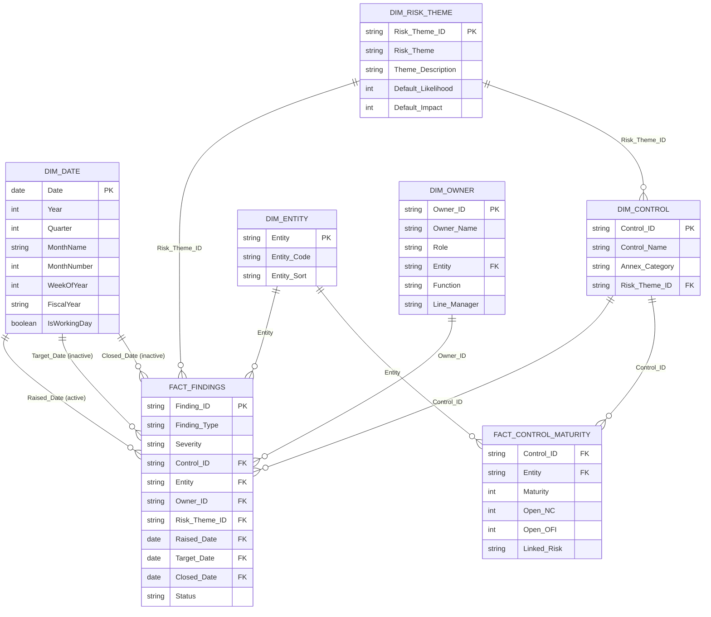

# Data model

The model is a **star schema** with two fact tables and five shared dimensions. The two facts are never related to each other. Filters flow from dimensions to facts. This keeps measures predictable when a slicer on entity, control, owner, theme or date is used.

```
                    ┌──────────────┐
                    │  Dim Date    │
                    └──────┬───────┘
                           │
         Raised / Target / Closed / Assessed (see relationships)
                           │
┌─────────────┐     ┌──────┴───────┐     ┌─────────────────────┐
│ Dim Control ├─────► Fact Findings │     │ Fact ControlMaturity│
└─────────────┘     └──────┬───────┘     └──────────┬──────────┘
                           │                         │
┌─────────────┐            │            ┌────────────┘
│ Dim Entity  ├────────────┼────────────┤
└─────────────┘            │            │
┌─────────────┐            │            │
│ Dim Owner   ├────────────┘            │
└─────────────┘                         │
┌─────────────┐                         │
│ Dim Risk    ├─────────────────────────┘  (via Control, or denormalised theme key)
│ Theme       │
└─────────────┘
```

The authoritative relationship view is the mermaid diagram below.

## Mermaid ER diagram



## Tables

### Fact Findings

Loaded from **Internal Audit Findings**. Grain: one finding. This is the primary fact for pages 1–4.

Do not leave typographic synonyms in `Finding_Type`, `Severity` or `Status`. Map them once in Power Query to the canonical lists in `docs/01-source-workbook-spec.md`.

Calculated columns (or equivalent measures — see `dax/measures.dax`) are added after load:

- `Age_Days`
- `Days_to_Close`
- `Is_Overdue`
- `Closed_On_Time`
- `Ageing_Bucket`

### Fact Control Maturity

Loaded from **Control Maturity** after unpivoting the entity blocks. Grain: one control + one entity.

| Column | Type | Notes |
| --- | --- | --- |
| Control_ID | Text | Key to Dim Control |
| Entity | Text | Key to Dim Entity (prefix translated to the display name) |
| Maturity | Whole number | 1–5 |
| Open_NC | Whole number | Prefer to treat as stored evidence; you can also reconcile to Findings with a measure |
| Open_OFI | Whole number | |
| Linked_Risk | Text | Existing risk-register id, if any |

If your prefixes differ, edit the prefix list in `powerquery/03-control-maturity.m`.

### Dim Date

Built in Power Query from a start and end date (see `powerquery/04-date-table.m`). Mark as the official date table in Power BI.

Recommended range: 1 January of the earliest `Raised_Date` year, through 31 December of next year (or `Date.EndOfYear(DateTime.LocalNow()) + 1 year`).

Useful columns: `Date`, `Year`, `Quarter`, `QuarterName`, `MonthNumber`, `MonthName`, `YearMonth`, `YearMonthSort`, `WeekOfYear`, `DayOfWeek`, `DayName`, `IsWorkingDay` (Mon–Fri, no public-holiday calendar unless you add one), `FiscalYear` and `FiscalQuarter` with a 1 April start (common in the UK; change the start month if needed).

### Dim Control

Distinct Annex A controls. In the sample this is derived from the Risk Theme Mapping sheet (one row per control, with its primary theme). You can also maintain a static controls table.

Columns: `Control_ID`, `Control_Name`, `Annex_Category`, `Risk_Theme_ID`.

### Dim Entity

Small lookup of reporting entities. In the sample: United Kingdom, Spain, France, Germany, plus `Group` for central owners.

Columns: `Entity`, `Entity_Code`, `Entity_Sort` (to keep a stable column order in matrices).

### Dim Owner

Loaded from the **Owners** sheet. Columns as specified in the workbook spec. Relate `Owner_ID` to Findings. An optional, inactive or many-to-one relationship from `Dim Owner[Entity]` to `Dim Entity[Entity]` can be used for “owners based in this country” filters; do not make it active if it would create ambiguity with the finding’s own entity.

### Dim Risk Theme

Distinct themes from the mapping sheet: `Risk_Theme_ID`, `Risk_Theme`, `Theme_Description`, `Default_Likelihood`, `Default_Impact`.

Control-to-theme is already on Dim Control, so Fact Control Maturity inherits a theme through Control. Findings also carry `Risk_Theme_ID` directly so a finding remains filterable even if its control mapping later changes. Keep the two in step in the source workbook.

## Relationships

Create these in Model view. All are single-direction (dimension filters fact) unless noted.

| From (1) | To (*) | On | Active? | Purpose |
| --- | --- | --- | --- | --- |
| Dim Date[Date] | Fact Findings[Raised_Date] | Date | Yes | Default time intelligence: when findings were raised |
| Dim Date[Date] | Fact Findings[Target_Date] | Date | No | Use with `USERELATIONSHIP` for “due in this period” |
| Dim Date[Date] | Fact Findings[Closed_Date] | Date | No | Use with `USERELATIONSHIP` for “closed in this period” |
| Dim Control[Control_ID] | Fact Findings[Control_ID] | Text | Yes | |
| Dim Control[Control_ID] | Fact Control Maturity[Control_ID] | Text | Yes | |
| Dim Entity[Entity] | Fact Findings[Entity] | Text | Yes | |
| Dim Entity[Entity] | Fact Control Maturity[Entity] | Text | Yes | |
| Dim Owner[Owner_ID] | Fact Findings[Owner_ID] | Text | Yes | |
| Dim Risk Theme[Risk_Theme_ID] | Fact Findings[Risk_Theme_ID] | Text | Yes | |
| Dim Risk Theme[Risk_Theme_ID] | Dim Control[Risk_Theme_ID] | Text | Yes | Lets theme slicers reach maturity via Control |

Do **not** create a relationship between Fact Findings and Fact Control Maturity. If you need “maturity of the control this finding sits on”, use `TREATAS` or a measure that looks up via Control and Entity, as in `dax/measures.dax`.

Hide technical keys from Report view once relationships are in place (`Finding_ID` may stay visible because it is useful on drill-through).

## Power Query steps (overview)

Detailed M is in `powerquery/`. The intended sequence is:

1. **Create parameters** — workbook path and the four sheet names (`01-parameters.m`).
2. **Staging** — one “raw” query per sheet, with columns renamed to canonical names using your mapping table. Set types. Remove the `Data_Flag` column in live use, or leave it and filter it out of visuals.
3. **Fact Findings** — clean lists, trim text, fix dates, add a quality query (duplicates, missing keys) that you can keep disabled.
4. **Fact Control Maturity** — unpivot entity blocks:
   1. Hold the shared columns (`Control_ID`, `Control_Name`, `Annex_Category`).
   2. Unpivot all other columns to `Attribute`, `Value`.
   3. Split `Attribute` into `Entity_Code` and `Metric` on the first underscore (or on your chosen delimiter).
   4. Map `Entity_Code` to the Dim Entity display name.
   5. Pivot `Metric` back to `Maturity`, `Open_NC`, `Open_OFI`, `Linked_Risk`.
   6. Set types.
5. **Dim Date** — generate with `List.Dates`.
6. **Dimensions** — distinct Control, Entity, Owner, Risk Theme. Disable load on staging queries; enable load only on facts and dims.

Refresh should be one click once the parameter points at the live file.

## Alternative layouts

If your maturity sheet is already tall (one row per control per entity), skip the unpivot and load it directly as Fact Control Maturity.

If you report on business units rather than countries, treat them as entities. Nothing in the DAX depends on the entity being a country.

## Naming conventions

- Fact tables: `Fact Findings`, `Fact Control Maturity`
- Dimensions: `Dim Date`, `Dim Control`, `Dim Entity`, `Dim Owner`, `Dim Risk Theme`
- Measures live in a display folder, grouped as `_Base`, `Ageing`, `Types`, `Maturity`, `Ownership`, `Risk`
- Prefix hidden helper measures with `_` so they sort together
